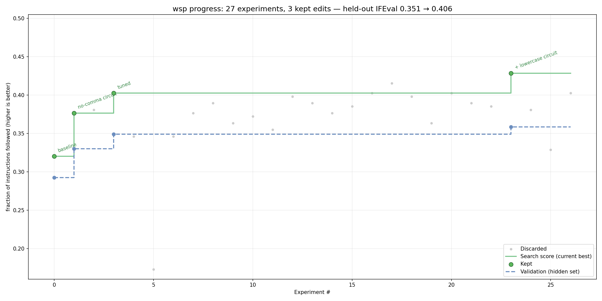

# wsp

> "No human is involved in writing this code because there are a lot of weights (typical networks might have millions), and coding directly in weights is kind of hard (I tried)."
> — Andrej Karpathy, [Software 2.0](https://karpathy.medium.com/software-2-0-a64152b37c35) (2017)

Agents can read a neural network's weights, work out what each part computes, and edit them directly to meet a goal, checking their work with a fixed budget of forward passes without an optimiser. [Weight-space programming](https://rikiyat.github.io/blog/weight-space-programming/) (Takehi et al., 2026) in the style of [autoresearch](https://github.com/karpathy/autoresearch).

## Files

- `harness.py` — loads the task, meters forward passes, scores edits and runs the held-out evaluation.
- `tools.py` — read and edit weights of any architecture.
- `edit.py` — file for agent to edit.
- `program.md` — agent instructions to modify.

## Tasks

Point `WSP_TASK` at a directory with:

- `task.md` — the goal, what inputs and outputs mean, where the weights came from, what one forward pass returns, what must not break.
- `task.py` — defines `BUDGET`, `REPEATS`, `SCORE_PASSES`, and `weights()`, `reference()` (optional), `model(w)`, `forward(model, **kw)`, `score(model)`, `val(model)`, `heldout(model)`.

`score` and `val` return a dict with `score`. `val` is a separate set the agent sees only as a number. Score, val and held-out should not share inputs. Tasks that need extra packages can list them in `task.md`.

## Quick start

    uv sync
    export WSP_TASK=/path/to/task
    uv run harness.py check
    uv run harness.py baseline

Then point your agent at `program.md`

`uv run harness.py heldout` for checkpoints

## Citation

This repo builds on:

    @misc{takehi2026weightspace,
      title        = {{Sparks of Weight-Space Programming: LLMs can natively read \& write neural network weights}},
      author       = {Takehi, Rikiya and Teoh, Jayden and Zhang, Alex and Khattab, Omar},
      year         = {2026},
      month        = nov,
      howpublished = {\url{https://rikiyat.github.io/blog/weight-space-programming/}},
      note         = {Blog post}
    }
